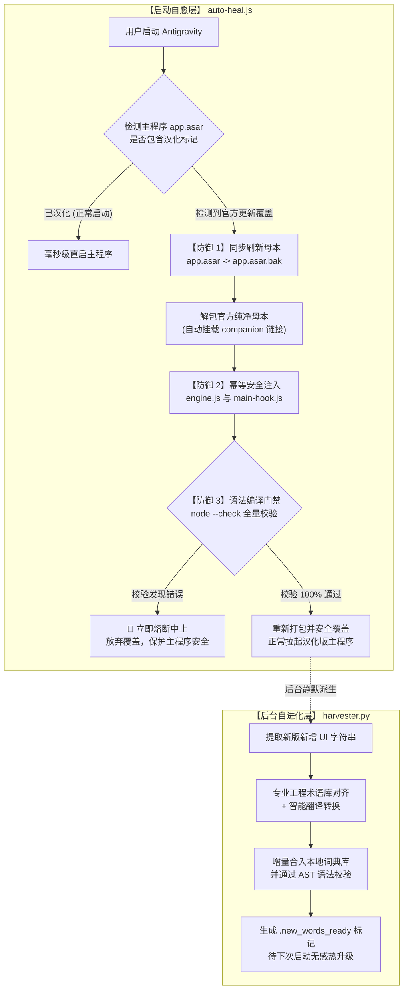

# Antigravity Auto-Heal (反重力无感自愈汉化体系)

> **彻底颠覆传统“手动复制替换 asar”的全新一代 Electron 自动化自愈与自进化本地化体系**。  
> 专为 Google Antigravity 高频敏捷迭代（每 3~5 天一次静默更新）设计，实现 **100% 零人工介入、开机毫秒级自愈、语法熔断零事故、后台差分自进化**。

🎬 **43 秒看懂本项目**：[docs/intro.mp4](docs/intro.mp4)（视频源码在 [`video/`](video/)，基于 Remotion，可自行修改重渲染）

---

## 💡 为什么我们需要全新的思路？

### 传统汉化方案的致命硬伤
全网现有的主流汉化模式都是：**作者手工解包修改 -> 重新打包 asar -> 上传网盘 -> 用户每次手动下载覆盖**。
- **与版本强绑定，更新即失效**：现代桌面端工具多采用 3~5 天一次的高频静默更新。官方一更新，汉化直接被覆盖失效；若强行用旧版 asar 覆盖，新功能丢失甚至导致主进程白屏报错。
- **维护成本沉重**：作者疲于切包，用户每次更新都要重新走一遍“关闭软件-找路径-粘贴覆盖”的繁琐流程。

### 本项目的破局理念：三位一体自动化闭环
1. **解耦业务代码（运行时动态 DOM + 主进程 Hook）**：不碰底层复杂压缩混淆的业务源码，通过轻量 `preload.js` 在渲染进程使用高性能微任务队列批量拦截替换 DOM，主进程 Hook 原生菜单与弹窗。
2. **零点击启动自愈环（Auto-Healing Daemon）**：启动瞬间自动差分比对。检测到官方静默更新后，毫秒级将官方新版本归档为纯净母本，就地安全注入，启动即汉化。
3. **后台采掘自进化（Autonomous Harvester）**：后台自动比对新增未翻译词条，配合专业软件工程术语库与代理翻译对齐，自动热升级本地词典。

---

## 🏛️ 体系架构全景图



---

## 🛡️ 核心四大防御机制 (Safety Guardrails)

在经历实战检验与演进中，本项目固化了四重工业级安全防护：

1. **纯净母本唯一提取源原则（Source of Truth）**：
   - 提取代码永远来自官方未修改的原版备份 `app.asar.bak`。
   - 官方更新时，母本自动刷新为新版本原版；词典更新时，永远在纯净母本上做加法，**彻底根绝在已修改代码上“叠罗汉”追加导致变量重复定义的崩溃（如 `SyntaxError: Identifier has already been declared`）**。
2. **幂等性注入查重（Idempotency Guard）**：
   - 每一个文件注入点均自带代码指纹校验（如 `if (!mContent.includes('const menuTranslationMap'))`），确保多次执行绝对不重复添加同一段代码。
3. **打包前语法熔断器（Pre-pack Syntax Gate）**：
   - 在重新封装为 `.asar` 之前，必须对所有修改过的 `.js` 文件逐一做进程内编译检查（等价于 `node --check`）。
   - 整个构建在内存中完成，只要任何一处报错就直接放弃，绝不修改用户软件目录的主文件；写入时先落临时文件再原子改名。
4. **单字兜底收敛防线（Strict Single-Word Fallback）**：
   - 严禁对未收录的多词短语进行盲目逐词拆解替换，**彻底根绝类似 `Open Links In` 被拆解翻译成 `打开 Links In` 的半中半英夹杂现象**。
   - 多词短语必须整句精确命中词典；未收录则完整保持优雅的英文原样。

---

## 📁 目录结构

```text
antigravity-auto-heal/
├── tool/
│   ├── runtime/
│   │   ├── engine.js         # 渲染进程 DOM 汉化引擎 (MutationObserver 批量微任务优化)
│   │   └── main-hook.js      # 主进程原生菜单 (Menu) 与系统弹窗 (dialog) Hook
│   ├── lib/
│   │   ├── asar.js           # 零依赖 asar 读取与内存重打包器 (不再依赖 npx / 联网)
│   │   └── patcher.js        # 注入 + 语法门禁 + 构建版本戳 (自愈与手动构建共用同一份逻辑)
│   ├── auto-heal.js          # 无感静默自愈守护核心 (母本同步 + 版本戳比对)
│   ├── builder.js            # 手动离线构建入口
│   └── harvester.py          # 后台采掘器 (只写外部词库，绝不改动 engine.js)
├── 启动Antigravity(带自动自愈).bat  # 毫秒级自愈的一键启动器 (支持可选自定义代理)
├── 一键汉化新版.bat                     # 手动本地一键编译构建脚本 (CMD 环境)
├── 一键汉化新版.ps1                     # 手动本地一键编译构建脚本 (PowerShell 7+ 环境)
├── package.json
├── .gitignore
└── README.md
```

---

## 🚀 快速上手

### 1. 前置依赖
- [Node.js](https://nodejs.org/) (>= 18.0.0)
- Python 3.8+ (用于后台差分采掘)

### 2. 日常启动（推荐）
直接运行根目录下的 **`启动Antigravity(带自动自愈).bat`**（或为其创建桌面快捷方式）。  
启动器会静默完成自愈检查（已汉化时约 0.2 秒，需要重建时整包注入与校验约 50 毫秒），随后拉起 Antigravity 主程序。若您的网络需要走特定代理端口（如 7890/7897），可随时右键编辑该脚本顶部的可选代理配置。

除官方更新外，本仓库的 `engine.js` / `main-hook.js` 有改动（例如 `git pull` 拿到新词典）时，下次启动也会自动重建，无需手动 `--force`。查看当前状态：
```bash
node tool/auto-heal.js --status
```

### 3. 词库与在线机翻兜底
- **内置词典**（`tool/runtime/engine.js`）为人工校对词条，是唯一随仓库发布的词库，采掘器不会改写它。
- **外部增量词库**位于 `%APPDATA%\Antigravity\i18n\custom_dict.json`，由运行期机翻兜底与采掘器写入。它放在用户数据目录而非安装目录，官方更新不会清空它。
- 机翻兜底只处理界面上的**多词英文短语**，会把该短语发送给 Google 翻译 / MyMemory。文件树、路径面包屑、PDF 文本、AI 回复正文、对话标题与项目名一律不采集、不翻译。
- 如不希望任何界面文本外发，设置环境变量 `ANTIGRAVITY_I18N_NO_MT=1`，或在 `%APPDATA%\Antigravity\i18n\` 下新建一个名为 `no_mt` 的空文件即可彻底关闭。

### 4. 手动本地构建
若您需要单独为某一版本生成汉化后的 `.asar` 离线包：
```bash
node tool/builder.js "app2.28.0 未汉化.asar" "app2.28.0 已汉化.asar"
```

---

## 🌐 通用性与复用评估

本项目所采用的“母本自愈环 + 运行时 DOM 拦截 + 语法熔断门禁”架构，具有**极高的通用性（适配度约 85% ~ 90%）**。

市面上绝大多数现代桌面工具（如 **Cursor**、**Claude Desktop**、**Postman**、**Slack**、**Notion** 等）底层均采用 Electron + `resources/app.asar` + `preload.js` 架构。迁移至其他软件仅需简单调整：
1. **安全区黑名单类名**（如保护各软件特有的代码编辑器或思考链 class）。
2. **专属领域术语词典库**。

核心自愈逻辑、解包注入流程与语法门禁均可 100% 直接套用。

---

## 📄 授权协议

本项目采用 [MIT License](LICENSE) 开源协议。
